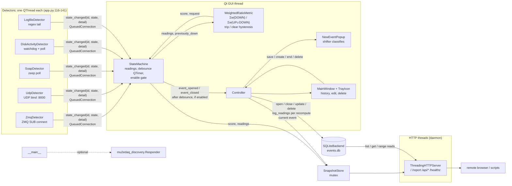

# mu2edaq-downtime-logger

> PySide6 desktop application that fuses pluggable DAQ liveness detectors into a weighted downtime score, prompts the shifter to classify each downtime, and records it in SQLite behind a read-only HTTP view

| | |
|---|---|
| Repository | `Mu2e/mu2edaq-downtime-logger` (public, issues enabled) |
| Language | Python ≥ 3.9 (`pyproject.toml:10`); PySide6, SQLAlchemy 2, pyzmq, zeep, watchdog |
| Version | 0.1.0 (`src/downtime_logger/__init__.py:1`) |
| Ports | 8088/tcp web view, code default and `config/config.example.yaml:18`; 8001/tcp on 127.0.0.1 in `config/local.yaml:11-12` (the file actually launched); 9000/udp inbound heartbeat (`config/config.example.yaml:45`, `config/local.yaml:28`) |
| Depends on | `mu2edaq-discovery` (optional import). The example config names `mu2edaq-dashboard`'s 5555 by accident; see `INTERFACES.md` §3 |
| Launched by | `mu2edaq-controlroom-setup` (`config/apps.yaml:47-55`, `crs-app start downtime-logger`) |

## Purpose

Account for DAQ downtime. The application watches several independent liveness
signals, combines them into one scalar score, and when the score crosses a
threshold it opens a *downtime event*: the event row is written immediately and a
popup asks the shifter to classify it (category, subsystem, cause, notes) while it
runs. When the score falls back, the event is closed. The embedded HTTP server
exposes the live state and a date-ranged report read-only.

The design isolates the decision rule in one swappable class
(`src/downtime_logger/core/metric.py:1-18`): detectors, state machine, storage and
UI do not depend on how the score is computed.

## Architecture

### Concurrency model

* **Detectors.** Each detector is constructed on the GUI thread, registered with
  the state machine, moved to a fresh `QThread` and started by a queued
  `invokeMethod` so that timers and socket notifiers created in `start()` get
  worker affinity (`src/downtime_logger/app.py:116-141`). `state_changed` is
  connected with an explicit `QueuedConnection` (`app.py:126-128`) so readings
  land on the GUI thread, where the debounce `QTimer` lives. The disk detector's
  `watchdog` observer adds one more OS thread per detector that only stores a
  float (`detectors/disk_detector.py:93-94`).
* **State machine, controller, UI, storage writes** all run on the GUI thread.
  Every storage call is synchronous (`app.py:145-249`); a slow database stalls
  the UI.
* **HTTP.** `ThreadingHTTPServer` on a daemon thread
  (`src/downtime_logger/web/server.py:511-557`), one thread per request. Live
  state comes from the lock-guarded `SnapshotStore`
  (`src/downtime_logger/web/snapshot.py:26-56`); history is read from SQLite on
  the request thread through the same engine (QueuePool, one connection per
  thread, `journal_mode=delete`, 5 s busy timeout). The snapshot copies the
  readings dict but not the `DetectorReading` objects, which the GUI thread
  mutates in place (`core/state_machine.py:71-73`); a request can observe a
  reading whose `state` and `detail` are from different updates. Harmless for a
  display.

### Event lifecycle

1. A detector transition triggers `_recompute` (`state_machine.py:131-146`):
   the metric returns `(score, request)`; `readings_changed` and
   `score_changed` are emitted; if the request differs from the current state a
   single-shot debounce timer is armed.
2. On expiry (`:148-166`) a DOWN request is dropped if monitoring is disabled
   (the default); otherwise `_open_event` builds a `DowntimeEvent` stamped *now*
   with `opened_by` = the DOWN detector ids (`:168-180`).
3. The controller writes the row (`app.py:154-158`), publishes it to the
   snapshot, and raises the popup (`:161-167`).
4. A later UP request closes it the same way (`state_machine.py:182-194`,
   `app.py:171-180`). The popup's header is refreshed with the closed event
   (`ui/popup_dialog.py:161-169`) but its *Ongoing* checkbox is not, so a Save
   pressed after recovery writes `ended_at = NULL` back over the closed row
   (DTL-021).
5. Shifter edits go through `update_event` (`app.py:182-195`); *End downtime now*
   force-closes the active event (`state_machine.py:100-119`); delete is a hard
   delete after a confirmation dialog (`app.py:217-240`).

Events survive only through the database: the state machine never reloads an
open event at startup, so a process that dies with an event open leaves an
orphan row (see `INTERFACES.md` §9).

## Components

| Path | Role |
|---|---|
| `src/downtime_logger/__main__.py` | argparse (`--config` required, `--log-level`), `QApplication`, optional discovery responder (`:39-48`), `SIGINT` handler + wake-up timer (`:51-54`) |
| `src/downtime_logger/app.py` | `Controller`: wires config → storage → metric → state machine → detectors → web → UI; cleanup on `aboutToQuit` |
| `src/downtime_logger/config.py` | YAML → dataclasses; required sections (`:46-56`), ≥1 detector (`:70-71`), unique ids (`:73-75`), web defaults (`:22-28`) |
| `src/downtime_logger/core/event.py` | `DetectorState`, `DetectorReading`, `DowntimeEvent` |
| `src/downtime_logger/core/metric.py` | `Metric` ABC, `WeightedRatioMetric` |
| `src/downtime_logger/core/state_machine.py` | readings, debounce, enable gate, open/close |
| `src/downtime_logger/core/plugin_loader.py` | `module.path:ClassName` → instance |
| `src/downtime_logger/detectors/` | `Detector` base and five detectors |
| `src/downtime_logger/storage/` | `StorageBackend` ABC, `SQLiteBackend` (SQLAlchemy ORM, two tables) |
| `src/downtime_logger/web/` | HTTP server and HTML/JSON rendering; `SnapshotStore` |
| `src/downtime_logger/ui/` | `MainWindow`, `EventEditor`/`NewEventPopup`, `StatusWidget`, `ToggleSwitch`, `TrayIcon` |
| `tools/` | one mock producer per detector (`zmq_publish`, `udp_broadcast`, `soap_server`, `disk_writer`, `log_writer`) |
| `start-…sh`, `stop-…sh`, `bootstrap.sh` | venv bootstrap, background start with PID file, SIGTERM/SIGKILL stop |
| `tests/` | 67 pytest/pytest-qt tests across 12 modules |
| `.github/workflows/ci.yml` | see below |

## Interfaces

`INTERFACES.md`: detector and storage plugin contracts, what each detector expects
on the wire, scoring semantics, HTTP API, timezone handling, discovery and signal
handling, and the full verdict on the dashboard ZMQ claim. Man pages:
`downtime_logger(3)`, `mu2edaq-downtime-logger.yaml(5)`,
`mu2edaq-downtime-logger-api(7)`.

## Configuration

One YAML file, passed with the required `--config`/`-c`
(`src/downtime_logger/__main__.py:17`). There is no environment-variable layer,
no `.env`, no search path and no reload; the site-wide
command line > environment > `.env` > file hierarchy does not apply to this
package. Sections `storage` and `metric` are required, `detectors` must be
non-empty, `webserver` defaults to disabled (`config.py:24`). Full key reference
with code defaults: `mu2edaq-downtime-logger.yaml(5)`.

Two files ship. `config/config.example.yaml` is a five-detector template whose ZMQ
and SOAP endpoints name the placeholder host `daq01` (DTL-006).
`config/local.yaml` is a workstation test file (UDP on loopback, `/tmp/daq-test`,
web on 127.0.0.1:8001) and is what the start script uses by default — including
when the control room launches it (DTL-013).

## Operations

See `OPERATIONS.md`. Two facts dominate: monitoring is **off** after every start
until a shifter enables it, and the stop script's `SIGTERM` does not run the
application's cleanup.

## Interactions with other packages

* **`mu2edaq-discovery`** — optional. Imported inside `try` at
  `src/downtime_logger/__main__.py:42`; failure logs a warning. Not a declared
  dependency because it is not on PyPI (`pyproject.toml:20-25`); `bootstrap.sh:58-62`
  installs the sibling checkout when present. Announces `app="downtime-logger"`
  with no `meta`.
* **`mu2edaq-dashboard`** — no working interaction. `config/config.example.yaml:35`
  points the ZMQ detector at `tcp://daq01:5555`; 5555 is the dashboard's
  `ZMQ_PULL` bind, which a SUB socket cannot read. Reclassified from the
  dashboard reviewer's S2 to S3 (`INTERFACES.md` §3, DTL-001). Not listed in
  `depends_on`: no shipped or deployed configuration connects to a dashboard.
* **`mu2edaq-controlroom-setup`** — launches this package
  (`mu2edaq-controlroom-setup/config/apps.yaml:47-55`; copies in
  `mu2edaq-config/config-*/mu2edaq-controlroom-setup/apps.yaml` and
  `mu2edaq-desktop/config/apps.yaml`). It registers `ports: {http: 8088}` and
  exports `CRS_PORT_HTTP=8088`, which this package never reads; the start script
  receives no arguments (`mu2edaq-controlroom-setup/server/crs-app:114-118`) and
  runs `config/local.yaml` on 127.0.0.1:8001. Inbound edge, so not in
  `depends_on`.
* **`mu2edaq-snapshot-viewer`** — its server binds `0.0.0.0:8001`
  (`mu2edaq-snapshot-viewer/config/server.yaml:9-10`), the same port as
  `config/local.yaml`. On a shared host whichever starts second fails to bind;
  for this package that aborts startup.
* **`mu2edaq-config`** — holds byte-identical copies of both config files under
  `config-main`, `config-t00.02.00-rc` and `config-t00.03.01`. Nothing loads them.

## Quality

* **Tests.** 67 test functions in 12 modules (`tests/`), pytest + pytest-qt,
  offscreen Qt. They cover config parsing, plugin loading, metric, state machine,
  SQLite storage, each detector against a local producer, UI smoke and the HTTP
  server. They do not cover: timezone behaviour across a non-UTC local zone, the
  editor round-trip, a popup Save after the event has closed, signal handling,
  a SUB/PULL mismatch, the ZMQ heartbeat timeout, or the logfile new-file case.
* **CI** (`.github/workflows/ci.yml`). Job `test`: Ubuntu, Python 3.10/3.11/3.12
  matrix, `QT_QPA_PLATFORM=offscreen`, apt Qt runtime libraries,
  `pip install -e .[dev]`, then each test module as its own step and a final
  `pytest -v`. Job `importable`: Python 3.12, runtime dependencies only, imports
  every module. Triggers: push and PR to `main`. Python 3.9 — the declared floor
  and the AlmaLinux 9 system interpreter — is not in the matrix (DTL-010).
* **Licence.** `LICENSE` is MIT; `pyproject.toml:12` declares Apache-2.0
  (DTL-019).
* **Hygiene.** `git ls-files` contains no venv, database, PID or log; `.gitignore`
  covers them. An untracked `events.db` sits in the working tree.

## Review findings

Staged in `ISSUES-PENDING.md` (GitHub writes are blocked for this review).
Fifteen individual issues and one roll-up.

| ID | Sev | Finding |
|---|---|---|
| DTL-002 | S2 | `clear_threshold` 0.2 is below what one stuck detector holds; events never auto-close |
| DTL-003 | S2 | SQLite returns naive datetimes; editing a past event moves its end by the UTC offset |
| DTL-013 | S2 | Control-room launch runs the workstation test config; web on loopback:8001, inventory says 8088 |
| DTL-014 | S2 | `SIGTERM` from the stop script orphans the open event; it inflates every later report |
| DTL-021 | S2 | Saving the DAQ DOWN popup after the event auto-closed reopens it in the database |
| DTL-001 | S3 | ZMQ detector SUB aimed at the dashboard's PULL port (reclassified from S2) |
| DTL-005 | S3 | Exception in a detector's `start()` leaves it silently UNKNOWN |
| DTL-010 | S3 | CI does not run Python 3.9 |
| DTL-011 | S3 | ZMQ/UDP state tokens substring-matched |
| DTL-015 | S3 | HTML pages interpolate detector detail and event text unescaped |
| DTL-016 | S3 | Monitoring disabled at every start, no override, not visible over HTTP |
| DTL-017 | S3 | `update_event` drops `started_at` edits |
| DTL-018 | S3 | Logfile tail skips lines written to a newly created file |
| DTL-004 | S4 | `detector_state_log` unbounded, unread |
| DTL-006 | S4 | Example config targets placeholder host `daq01` |
| DTL-020 | S4 | Roll-up: DTL-007 endpoint comment, DTL-008/009 man pages (fixed here), DTL-012 500 bodies echo exception text, DTL-019 licence metadata |
